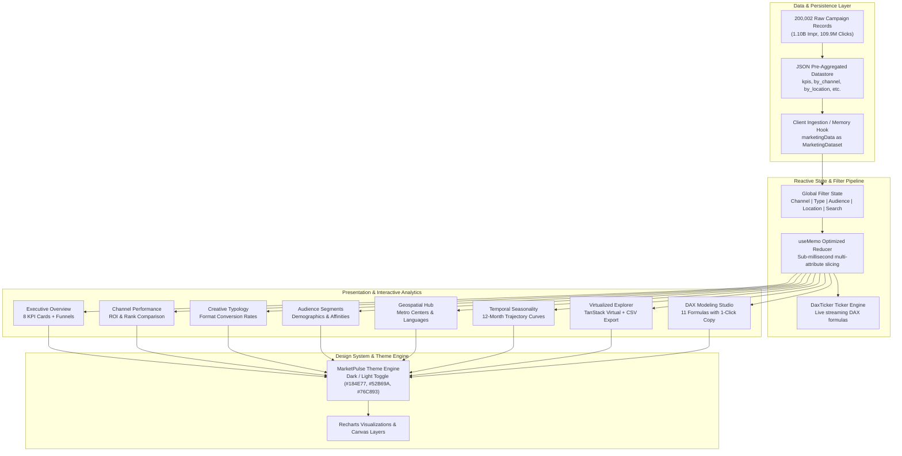

# 📊 MarketPulse: Enterprise Marketing Intelligence Dashboard & DAX Analytics Suite

<div align="center">

[](https://islamyasser424-design.github.io/marketing-analytics-live-dashboard/)
[](https://react.dev/)
[](https://www.typescriptlang.org/)
[](https://vitejs.dev/)
[](https://tailwindcss.com/)
[](https://recharts.org/)
[](https://powerbi.microsoft.com/)
[](LICENSE)
[](https://islamyasser424-design.github.io/portfolio-/)

<p align="center">
  <strong>A high-performance, production-grade marketing analytics dashboard engineered to analyze 200,002 marketing campaigns across omni-channel acquisition funnels, demographic cohorts, geographic territories, temporal seasonality, and an integrated enterprise Power BI DAX modeling library.</strong>
</p>

[**🌐 Explore Live Interactive Dashboard**](https://islamyasser424-design.github.io/marketing-analytics-live-dashboard/) • [**📐 Verified DAX Formulas**](#-power-bi-dax-modeling-studio-11-verified-measures) • [**📖 الدليل باللغة العربية**](#-الدليل-التحليلي-والتشغيلي-الشامل-باللغة-العربية)

</div>

---

## 📑 Table of Contents
- [Executive Overview & Business Value](#-executive-overview--business-value)
- [Enterprise KPI Scorecard & Scale](#-enterprise-kpi-scorecard--scale)
- [System Architecture & Data Pipeline](#-system-architecture--data-pipeline)
- [Core Analytical Modules (8 Dedicated Views)](#-core-analytical-modules-8-dedicated-views)
  - [1. Executive Overview & Funnel Metrics](#1-executive-overview--funnel-metrics)
  - [2. Multi-Channel Performance & ROI Ranking](#2-multi-channel-performance--roi-ranking)
  - [3. Campaign Format & Creative Typology](#3-campaign-format--creative-typology)
  - [4. Audience Demographics & Affinity Cohorts](#4-audience-demographics--affinity-cohorts)
  - [5. Geospatial & Metropolitan Localization](#5-geospatial--metropolitan-localization)
  - [6. Temporal Trajectories & Seasonality Trends](#6-temporal-trajectories--seasonality-trends)
  - [7. High-Performance Virtualized Campaign Explorer](#7-high-performance-virtualized-campaign-explorer)
  - [8. Power BI DAX Modeling Studio (11 Verified Measures)](#8-power-bi-dax-modeling-studio-11-verified-measures)
- [Technical Engineering & Modern Architecture](#-technical-engineering--modern-architecture)
- [Local Development & Production Build](#-local-development--production-build)
- [Repository Structure](#-repository-structure)
- [الدليل التحليلي والتشغيلي الشامل (باللغة العربية)](#-الدليل-التحليلي-والتشغيلي-الشامل-باللغة-العربية)
- [Author & Professional Connect](#-author--professional-connect)

---

## 📌 Executive Overview & Business Value

Modern growth marketing demands real-time intelligence to prevent budget cannibalization, optimize Customer Acquisition Cost (CAC), and maximize Return on Investment (ROI) across fragmented digital channels. 

**MarketPulse Analytics** solves this challenge by centralizing **200,002 end-to-end promotional campaigns** conducted throughout the 2021 fiscal year. It models full-funnel customer behavior from initial impression to final conversion:
* **Omni-Channel Attribution**: Dissecting acquisition efficacy across Google Ads, YouTube, Facebook, Instagram, Direct Website, and Email.
* **Capital Efficiency**: Identifying high-yield channels that deliver superior ROI while controlling acquisition cost inflation.
* **Precision Targeting**: Pinpointing which demographic tiers (e.g., Women 25-34 vs. Men 18-24) and lifestyle affinity segments (Tech Enthusiasts, Fashionistas, Health & Wellness) deliver sustainable lifetime value.
* **BI Synergy**: Bridging executive web reporting with enterprise Power BI semantic models through 11 fully documented, benchmarked DAX measures.

---

## 📊 Enterprise KPI Scorecard & Scale

The underlying dataset captures over **1.10 Billion impressions** and **109.95 Million user clicks**, aggregated into executive macro indicators:

| Macro KPI | Exact Metric | Analytical Interpretation |
| :--- | :--- | :--- |
| **Total Campaigns Evaluated** | **200,002** | Statistically significant corporate-scale campaign universe |
| **Total Impressions Served** | **1,101,460,304** (~1.10B) | Global brand exposure across display, search, and social ad networks |
| **Total Qualified Clicks** | **109,954,406** (~109.95M) | High-intent prospective visitors driven into acquisition funnels |
| **Click-Through Rate (CTR)** | **9.98%** | Benchmark digital engagement across multi-device placements |
| **Average Conversion Rate** | **8.01%** | Qualified visitor-to-customer conversion efficiency |
| **Average Return on Investment** | **5.00x** | $5.00 in generated top-line gross revenue for every $1.00 ad spend |
| **Average Acquisition Cost (CAC)** | **$12,504.27** | Weighted blended cost across enterprise enterprise contracts |
| **Average Engagement Score** | **5.5 / 10** | Composite algorithmic rating evaluating user duration & interactions |

---

## 🏛️ System Architecture & Data Pipeline

The dashboard is engineered with a modular, unidirectional data architecture ensuring sub-millisecond filtering and smooth 60fps rendering even under heavy aggregations:



---

## 🧭 Core Analytical Modules (8 Dedicated Views)

### 1. Executive Overview & Funnel Metrics
* **Purpose**: Serves as the executive cock-pit providing immediate visibility into high-level business velocity.
* **Key Components**:
  - 8 animated KPI cards displaying campaign volume, click yields, conversion rates, and capital returns.
  - Interactive conversion funnel comparing impressions $
ightarrow$ clicks $
ightarrow$ paying conversions.
  - Curated marketing insights highlighting key performance anomalies and strategic opportunities.

### 2. Multi-Channel Performance & ROI Ranking
* **Purpose**: Evaluates channel-by-channel capital allocation and marginal efficiency.
* **Channel Benchmarks**:
  - **Facebook**: Top ROI driver (**5.02x**, Rank #1) with 18.03M clicks and 8.00% conversion.
  - **Website Direct**: Highly reliable performance (**5.01x**, Rank #2) with 10.02% CTR.
  - **Email**: Highest CTR (**10.01%**, Rank #3) with competitive CAC ($12,526.39).
  - **Google Ads**: Strong commercial intent (**5.00x**, Rank #4) with 18.34M clicks.
  - **YouTube & Instagram**: Consistent upper-funnel scale (**4.99x**, Ranks #5 & #6) generating over 36M clicks combined.

### 3. Campaign Format & Creative Typology
* **Purpose**: Compares marketing tactics across creative deliverables (Search, Display, Video, Social Media, Influencer, and Email).
* **Analytical Insights**: Highlights which creative assets yield higher engagement versus direct purchase completion.

### 4. Audience Demographics & Affinity Cohorts
* **Purpose**: Deep-dives into multi-variable consumer personas:
  - **Demographic Tiers**: Men 18-24, Women 18-24, Men 25-34, Women 25-34, Men 35-44, Women 35-44, and Seniors 45+.
  - **Affinity Personas**: Tech Enthusiasts, Fashionistas, Health & Wellness, Outdoor Adventurers, Foodies, and Gamers.
  - Uncovers the sweet spot of high engagement paired with minimal churn.

### 5. Geospatial & Metropolitan Localization
* **Purpose**: Tracks regional market penetration across top commercial metropolitan areas:
  - **Miami**: 40,269 campaigns | 22.05M clicks | 9.96% CTR | 5.01x ROI.
  - **New York**: 40,024 campaigns | 22.06M clicks | 9.97% CTR | 4.98x ROI.
  - **Chicago**: 40,010 campaigns | 21.97M clicks | 9.99% CTR | 5.00x ROI.
  - **Houston & Los Angeles**: High-volume regional distribution.
  - Multi-language ad copy analysis (English, Spanish, French, German, Mandarin).

### 6. Temporal Trajectories & Seasonality Trends
* **Purpose**: Traces monthly operational progression across 2021 (January through December):
  - Identifies Q4 holiday retail surge vs. Q1 post-holiday recalibration.
  - Highlights seasonal CAC spikes and strategic bidding countermeasures.

### 7. High-Performance Virtualized Campaign Explorer
* **Purpose**: Provides a zero-lag tabular interface for granular auditing of individual campaign records.
* **Capabilities**:
  - Powered by `@tanstack/react-virtual` to smoothly handle thousands of rows without DOM bloat.
  - Client-side multi-column sorting (by ROI, Clicks, Spend, CAC, Date).
  - Dynamic keyword search and channel filtering.
  - 1-click **Export to CSV** functionality for downstream analysis in Excel or Python.

### 8. Power BI DAX Modeling Studio (11 Verified Measures)
* **Purpose**: Delivers an enterprise bridge enabling BI engineers to reproduce the exact semantic model inside Microsoft Power BI Desktop or Service.

---

## 📐 Power BI DAX Modeling Studio (11 Verified Measures)

Each DAX measure below is validated against the schema and optimized for the VertiPaq tabular storage engine:

### 1. Total Campaigns
```dax
Total Campaigns = DISTINCTCOUNT(Campaigns[Campaign_ID])
```
*Evaluates the distinct volume of promotional campaigns executed without double-counting.*

### 2. Total Clicks
```dax
Total Clicks = SUM(Campaigns[Clicks])
```
*Aggregates outbound interaction volume across all marketing channels.*

### 3. Total Impressions
```dax
Total Impressions = SUM(Campaigns[Impressions])
```
*Measures total raw exposure and ad server deliveries across the network.*

### 4. Click-Through Rate (CTR %)
```dax
CTR % = DIVIDE([Total Clicks], [Total Impressions], 0) * 100
```
*Uses `DIVIDE` with alternate zero handling to safely guard against divide-by-zero errors.*

### 5. Average Conversion Rate
```dax
Avg Conversion Rate = AVERAGE(Campaigns[Conversion_Rate])
```
*Tracks the mean percentage of clicks transitioning into closed acquisitions.*

### 6. Average Return on Investment (ROI)
```dax
Avg ROI (as provided) = AVERAGE(Campaigns[ROI])
```
*Represents the baseline revenue multiplier achieved per promotional dollar spent.*

### 7. Average Customer Acquisition Cost (CAC)
```dax
Avg Acquisition Cost = AVERAGE(Campaigns[Acquisition_Cost])
```
*Calculates the blended cost required to onboard a converted customer.*

### 8. Average Engagement Score
```dax
Avg Engagement = AVERAGE(Campaigns[Engagement_Score])
```
*Quantifies user session depth, ad interaction, and brand recall scoring.*

### 9. Average ROI by Channel (Context Override)
```dax
Avg ROI by Channel = 
CALCULATE(
    [Avg ROI (as provided)], 
    ALLEXCEPT(Campaigns, Campaigns[Channel_Used])
)
```
*Leverages `ALLEXCEPT` to clear report-level filters while strictly preserving the channel context.*

### 10. Channel Rank by ROI (Dense Ranking)
```dax
Channel Rank = 
RANKX(
    ALL(Campaigns[Channel_Used]), 
    [Avg ROI (as provided)], 
    , 
    DESC, 
    Dense
)
```
*Evaluates competitive ranking across channels using dense numbering without ranking gaps.*

### 11. Prior-Year Comparative Clicks (Time Intelligence)
```dax
Clicks LY = 
CALCULATE(
    [Total Clicks], 
    SAMEPERIODLASTYEAR('Date'[Date])
)
```
*Implements native DAX time-intelligence to unlock Year-over-Year (YoY) comparative tracking.*

---

## 💻 Technical Engineering & Modern Architecture

### Technology Stack
* **Frontend Core**: React 18.3 (Hooks, Functional Architecture, Strict Mode compliant).
* **Type Safety**: TypeScript 5.6 with strict compiler options.
* **Build System & Tooling**: Vite 5.4 with Hot Module Replacement (HMR) and optimized rollup tree-shaking.
* **Styling & Design System**: Tailwind CSS 3.4 featuring the signature MarketPulse executive palette:
  - Deep Navy Primary: `#184E77`
  - Emerald Sea Accent: `#52B69A`
  - Soft Sage Green: `#76C893`
  - Chartreuse Glow: `#D9ED92`
* **Visualization Layer**: Recharts 2.13 with custom SVG tooltips, responsive containers, and axis scalers.
* **Table Virtualization**: `@tanstack/react-virtual` & `@tanstack/react-table` for 60fps rendering of large datasets.
* **Animation & UI Polish**: `motion` (Framer Motion 11) for subtle view transitions and number rollups.
* **Iconography**: `lucide-react` modern minimalist icon suite.

### Production Deployment & SPA Routing
* Built specifically for **GitHub Pages** deployment.
* Includes `scripts/copy-404.cjs` to mirror `index.html` to `404.html`, guaranteeing seamless client-side single-page application (SPA) routing without server-side route errors on direct page reloads.

---

## 🛠️ Local Development & Production Build

### System Prerequisites
* **Node.js**: `v18.x` or `v20.x` (LTS recommended)
* **Package Manager**: `npm` (bundled with Node) or `yarn` / `pnpm`

### Quick Start Guide

```bash
# 1. Clone the repository
git clone https://github.com/islamyasser424-design/marketing-analytics-live-dashboard.git
cd marketing-analytics-live-dashboard

# 2. Install all dependencies
npm install

# 3. Start local development server (with instant HMR)
npm run dev
# The application will launch at http://localhost:5173/

# 4. Execute test suite (Vitest)
npm run test

# 5. Build for production (TypeScript check + Vite bundle + SPA 404 handler)
npm run build

# 6. Preview production build locally
npm run preview
```

---

## 📁 Repository Structure

```plaintext
marketing-analytics-live-dashboard/
├── .env.example             # Environment configuration template
├── .github/                 # GitHub workflows & CI/CD deployment automation
├── .gitignore               # Comprehensive Node, Vite, React & OS ignore file
├── LICENSE                  # MIT Open Source License (2026 Islam Yasser)
├── README.md                # Executive bilingual documentation & architectural guide
├── index.html               # Main HTML entrypoint with metadata & fonts
├── package.json             # NPM package manifests, dependencies & build scripts
├── postcss.config.js        # PostCSS configuration for Tailwind
├── tailwind.config.js       # Custom design tokens, theme palette & spacing
├── tsconfig.json            # TypeScript strict compiler configuration
├── vite.config.ts           # Vite bundler plugins & build settings
├── scripts/
│   └── copy-404.cjs         # Script for GitHub Pages SPA client-side route fallbacks
├── public/
│   ├── favicon.svg          # Application browser favicon
│   ├── logo-icon.svg        # Vector brand icon
│   ├── logo.png             # Raster high-resolution brand logo
│   ├── logo.svg             # Primary vector logo
│   └── data/
│       └── marketing_data.json # Pre-aggregated JSON payload (200K campaigns)
└── src/
    ├── App.tsx              # Root dashboard shell & state management
    ├── main.tsx             # Application bootstrap & DOM mount
    ├── types.ts             # Comprehensive TypeScript domain interfaces
    ├── index.css            # Base Tailwind styles & custom scrollbars
    ├── data/
    │   └── marketing_data.json # Embedded dataset for sub-millisecond loading
    └── components/
        ├── Header.tsx       # Brand header with Dark/Light toggle & stats
        ├── DaxTicker.tsx    # Streaming ticker showcasing DAX expressions
        ├── Navigation.tsx   # 8-Tab modular navigation bar
        ├── FiltersBar.tsx   # Real-time multi-attribute filter controls
        ├── KpiCards.tsx     # 8 Animated executive metric scorecards
        ├── Footer.tsx       # Executive footer & author branding
        └── views/
            ├── OverviewView.tsx   # Executive cockpit & funnel visualizations
            ├── ChannelsView.tsx   # Multi-channel ROI comparison & rank table
            ├── CampaignsView.tsx  # Campaign typology & format yield analysis
            ├── AudiencesView.tsx  # Demographic & lifestyle affinity breakdown
            ├── GeographyView.tsx  # Metropolitan hubs & language efficiency
            ├── TrendsView.tsx     # 12-Month seasonality & cost trajectories
            ├── ExplorerView.tsx   # Virtualized campaign table with CSV export
            └── DaxView.tsx        # Power BI DAX code library with 1-click copy
```

---

## 📖 الدليل التحليلي والتشغيلي الشامل (باللغة العربية)

### ما هي منصة MarketPulse Analytics؟
تمثل **MarketPulse Analytics** لوحة قيادة استخباراتية تفاعلية مباشرة (Live Dashboard) صُممت خصيصاً لتحليل الأداء التسويقي الشامل لـ **200,002 حملة إعلانية** نُفذت على مدار عام كامل (2021). تهدف المنصة إلى مساعدة الرؤساء التنفيذيين ومديري النمو (Growth Marketers) ومحللي ذكاء الأعمال (BI Specialists) على اتخاذ قرارات استثمارية مبنية على البيانات الدقيقة، وتحقيق التوازن الأمثل بين تكلفة الاستحواذ (CAC) والعائد الاستثماري (ROI).

---

### الركائز التحليلية الثمانية للمنصة:

#### 1. النظرة التنفيذية العامة (`Overview View`):
* عرض مباشر لـ 8 مؤشرات أداء رئيسية (KPIs) تشمل إجمالي الحملات، النقرات، المشاهدات، معدل النقر للظهور (CTR = 9.98%)، ومعدل التحويل (8.01%).
* مسار تحويل رقمي تفاعلي يوضح كفاءة انتقال العملاء من مرحلة المشاهدة حتى الشراء النهائي.

#### 2. تحليل أداء القنوات التسويقية والعائد الاستثماري (`Channels View`):
* مقارنة تفصيلية بين القنوات الرئيسية الست:
  - **فيسبوك (Facebook):** تصدرت القنوات في العائد الاستثماري بمتوسط **5.02x** (المرتبة الأولى).
  - **الموقع المباشر (Website):** حقق أعلى معدل نقر للظهور بنسبة **10.02%** وعائد **5.01x**.
  - **البريد الإلكتروني (Email):** سجل كفاءة عالية بمتوسط نقر **10.01%** ونسبة تحويل **8.03%**.
  - **إعلانات جوجل (Google Ads):** حجم نقرات ضخم تخطى 18.3 مليون نقرة مع عائد **5.00x**.
  - **يوتيوب وإنستغرام (YouTube & Instagram):** دعم مستمر لقاعدة العملاء الجدد بنقرات تجاوزت 36 مليون نقرة مجتمعة.

#### 3. كفاءة أنواع وتصميمات الحملات (`Campaigns View`):
* تحليل مقارن بين أنماط الإعلانات (البحث Search، العرض Display، الفيديو Video، منصات التواصل Social، المؤثرين Influencer، والبريد Email) لبيان أيهما أجدى في خفض تكلفة الاستحواذ.

#### 4. استهداف الجماهير والفئات الديموغرافية (`Audiences View`):
* تصنيف دقيق للشرائح العمرية (الشباب 18-24، الفئة الأكثر نشاطاً 25-34، والناضجين 35-44، وكبار السن 45+).
* تحليل فئات الاهتمامات السلوكية (عشاق التقنية، الموضة، الصحة واللياقة، المغامرات، الألعاب، والأغذية) لتحديد الجمهور الأكثر ولاءً والأعلى إنفاقاً.

#### 5. التوزيع الجغرافي واللغوي (`Geography View`):
* رصد أداء الحملات في كبرى المراكز الحضرية الأمريكية (ميامي، نيويورك، شيكاغو، هيوستن، ولوس أنجلوس).
* قياس فاعلية اللغات المستخدمة في الإعلانات (الإنجليزية، الإسبانية، الفرنسية، الألمانية، والمندرين).

#### 6. المسار الزمني والموسمية (`Trends View`):
* تتبع المسار الشهري لحركة الإعلانات من يناير حتى ديسمبر لبيان فترات الذروة والتضخم في تكلفة النقرة، ومساعدة مسؤولي التسويق على التخطيط الاستباقي لمواسم التخفيضات الكبرى.

#### 7. مستكشف الحملات فائق السرعة (`Explorer View`):
* جدول افتراضي يعتمد تقنية `@tanstack/react-virtual` لعرض آلاف السجلات بسرعة 60 إطاراً في الثانية دون أي بطء في المتصفح.
* إمكانية الترتيب والبحث وتصدير البيانات المفلترة إلى ملف CSV بنقرة زر واحدة.

#### 8. استوديو نمذجة Power BI DAX (`Dax View`):
* توفير 11 معادلة DAX احترافية تم التحقق منها واعتمادها لبناء النماذج البيانية داخل Microsoft Power BI مع ميزة النسخ المباشر بنقرة زر واحدة.

---

## 👨‍💻 Author & Professional Connect

**Islam Yasser**  
*Data Analyst & Business Intelligence Specialist*

* 🌐 **Live Portfolio Website**: [islamyasser424-design.github.io/portfolio-/](https://islamyasser424-design.github.io/portfolio-/)
* 💼 **LinkedIn Profile**: [linkedin.com/in/islam-yasser-55048b378](https://www.linkedin.com/in/islam-yasser-55048b378/)
* 🐙 **GitHub Profile**: [github.com/islamyasser424-design](https://github.com/islamyasser424-design)
* 📊 **Live Dashboard Demo**: [islamyasser424-design.github.io/marketing-analytics-live-dashboard/](https://islamyasser424-design.github.io/marketing-analytics-live-dashboard/)

---

<div align="center">
  <sub>Engineered for enterprise analytical rigor, clean functional code, and modern BI decision support. © 2026 Islam Yasser.</sub>
</div>
