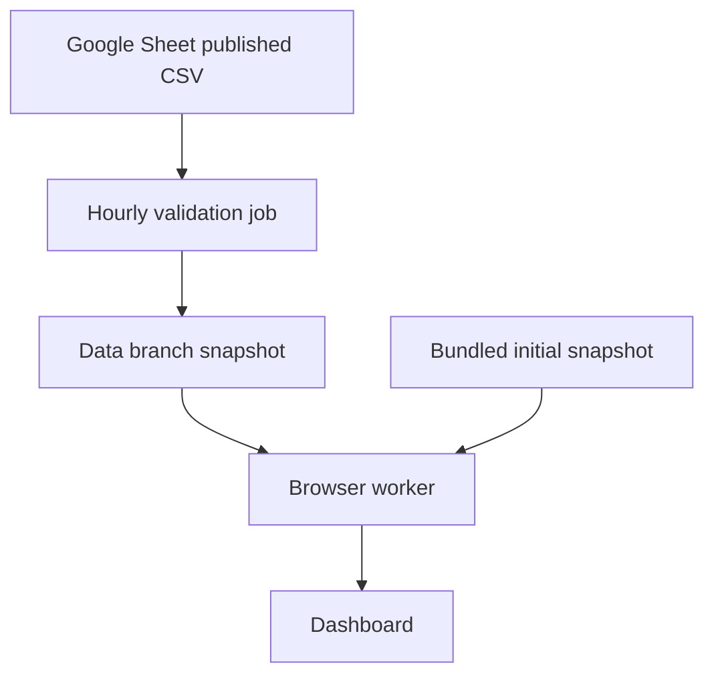

# MarketPulse Analytics

A static marketing campaign dashboard for a fictional, public Google Sheets dataset. It uses React, Vite, TypeScript, Recharts, TanStack Query and a Web Worker. An hourly GitHub Action validates the sheet export and publishes immutable, compressed snapshots to a `data` branch. The frontend fetches those files at runtime; a frontend redeploy is not required for updated data.

## How it works



The dashboard initially loads the aggregate cube. Campaign Explorer, CSV export, and the optional top-campaign table lazily load the dictionary-encoded columnar records. The worker applies all filters and computes aggregates locally. A bundled snapshot is included for the first deploy. The data branch is public and uses immutable data filenames plus a latest manifest in one Git commit. If a refresh fails during a session, the worker retains the last loaded snapshot and displays a warning. The data files and the original dataset are public: do not use private data with this setup.

The app checks the latest *published snapshot*, by default every five minutes, on focus, and when Refresh is clicked. The ingestion job is scheduled hourly; data can lag the Sheet by an hour plus GitHub scheduling, fetch, processing and caching delays. Scheduled jobs can fail or be delayed, so this is not real-time. Manual refresh checks the data branch; it does not start the GitHub ingestion job. The initial bundled snapshot is used when the data branch is unavailable, and the UI labels it accordingly.

## Browser-only GitHub setup

1. Extract the ZIP. On GitHub, create a public repository named `marketing-analytics-live-dashboard`. Choose an empty repository.
2. On the repository's empty-page screen click **uploading an existing file**. Upload the *contents* of the extracted project, preserving folders. Include hidden files and folders such as `.github`, `.gitignore`, and `.env.example`; enable hidden files in your computer's file manager if necessary. Commit to `main`. Do not upload `node_modules`, `dist`, local `.env`, or SQLite files. The initial `public/data` snapshot must be included.
3. In **Settings → Actions → General → Workflow permissions**, choose **Read and write permissions**, then **Save**.
4. In **Settings → Secrets and variables → Actions → Variables → New repository variable**, create `SHEET_CSV_URL` with the actual published, read-only CSV URL. The placeholder in the original instructions is not a URL.
5. In **Settings → Pages → Build and deployment → Source**, choose **GitHub Actions**.
6. In **Actions**, select **Refresh campaign data → Run workflow → Run workflow**. Wait for a green result. It creates the `data` branch. If the URL variable is absent or the row count drops by more than 5%, the workflow fails and the previous snapshot stays published.
7. Select **Deploy dashboard → Run workflow → Run workflow** and wait for a green result. The expected address is `https://OWNER.github.io/marketing-analytics-live-dashboard/`, replacing OWNER with the account name. Verify it opens; no live URL is implied by this package alone.

GitHub's browser upload accepts up to 100 files per upload and 25 MiB per file. Upload in batches if needed, retaining each folder's path. The included compressed snapshot files are each under 4 MiB. The `.github/workflows` folder must exist in the repository for Actions to appear. The initial snapshot can display without a data branch, but it cannot update until the variable is configured and the refresh workflow succeeds.

## Local development and checks

Node 20+ and Python 3.12+:

```sh
npm ci
npm run dev
npm run build
node tests/worker.test.mjs
python3 -m unittest discover -s service -p 'test_*.py' -v
```

Local development uses `public/data/latest.json` and its bundled files. For a custom published data location, set `VITE_DATA_BASE_URL` to a URL ending in `/` before building. GitHub's deployment workflow automatically sets it to the repository's public `data` branch. A private source or private repository is not supported by this static browser design. The older `service/server.py` is retained for reference and is not used by the frontend.

To regenerate local snapshots, set `SHEET_CSV_URL` or download the CSV and run:

```sh
python3 service/publish_snapshot.py --file /path/to/export.csv --out public/data --previous public/data/latest.json
```

The refresh job checks the prior `data/latest.json`, or the bundled manifest on its first run, and refuses a populated-row drop over 5%. Investigate a legitimate large deletion before deliberately changing the baseline. The check cannot detect every kind of truncation or erroneous edit. The data branch keeps historical immutable files and Git history, which grows as the dataset changes; monitor repository storage. Publication is one commit containing manifest and files; failed validation or push leaves the previous commit available.

## KPI methodology and data quality

CTR is `sum(clicks) / sum(impressions) × 100`; zero impressions gives no CTR. Conversion, ROI, cost and engagement use unweighted averages of valid campaign records. Acquisition cost is treated as per-customer and never presented as total spend. The sheet's `$` formatting is retained; the currency code is not confirmed. ROI is displayed **as provided, unit unverified**. Revenue, profit, spend, conversions and ROAS are not inferred.

Campaign Date is the date the campaign occurred. The initial export covers 2021-01-01 through 2021-12-31, despite the source description's approximate two-year claim. Trends support monthly and quarterly views, not annual grouping. Engagement must be 1–10; duration is parsed in days; conversion must carry an unambiguous percent sign. Required blanks and invalid fields exclude the entire record, and the data-quality page reports reasons and row numbers. The ingestion retains duplicate IDs as separate rows. The 200,000-row initial export contained no invalid rows or duplicate IDs.

Insights are deterministic descriptive comparisons. Every current insight requires at least 100 campaigns in each compared group and a 10% relative difference threshold; smaller gaps are described as “No meaningful difference.” This screening threshold is a product heuristic, not evidence of statistical significance or causality.

## Limits and troubleshooting

- The supplied CSV link was a placeholder; set the real published CSV URL as the repository variable before running the refresh job.
- The initial gzip files were measured at about 3.24 MiB (columnar) and 3.54 MiB (cube). Browser download and worker load times have not been measured. `benchmark/index.html` provides a local test; serve the `benchmark` folder over HTTP.
- A modern browser supporting Web Workers and `DecompressionStream('gzip')` is required. Browser compatibility, low-memory devices, and GitHub CDN caching must be checked on the deployed site.
- This is a local worker implementation: all aggregate cube data reaches the browser and the full campaign data is downloaded when Explorer, export, or top campaigns is requested. The historical requirement for a server-side paginated API is intentionally superseded by the static architecture decision.
- If the app shows a bundled snapshot or error, check the refresh workflow run and variable, `data` branch contents, repository visibility, and the browser's network panel. If Pages fails, confirm **Settings → Pages → GitHub Actions** and inspect the Deploy dashboard run.
- Never commit credentials. The public CSV URL is a repository variable; it is not a secret and must be usable by the GitHub runner without authentication.
